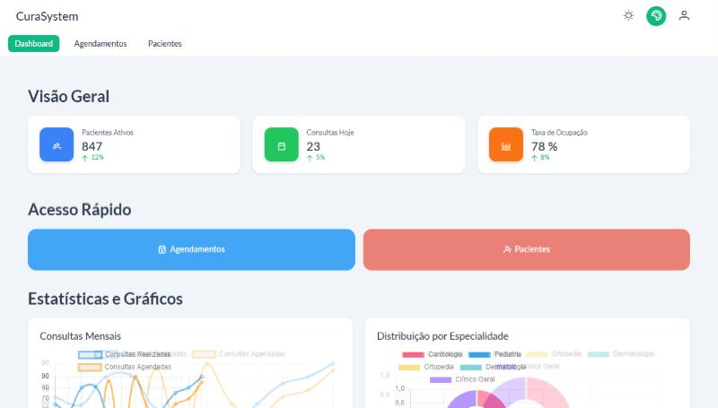
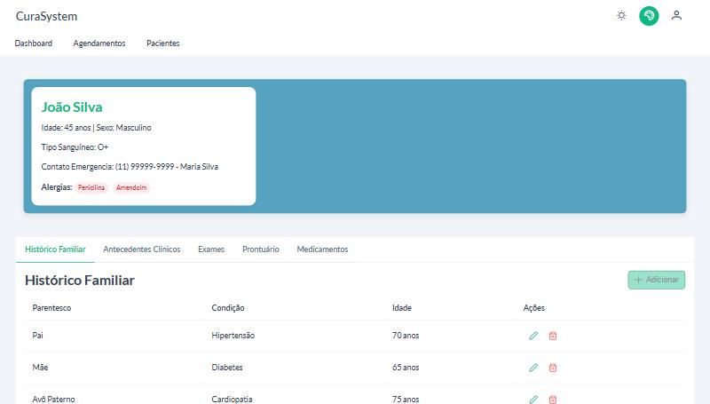
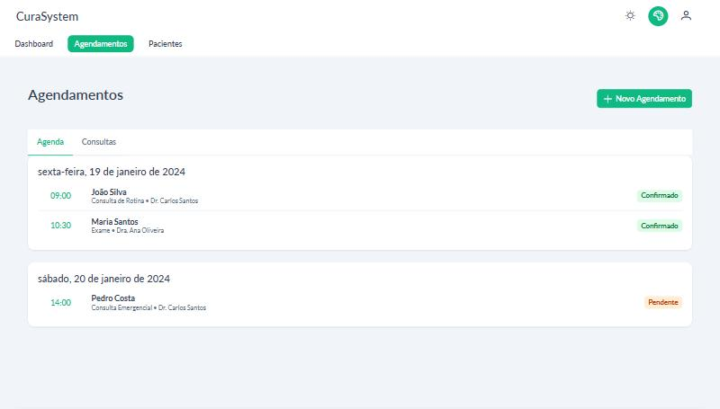
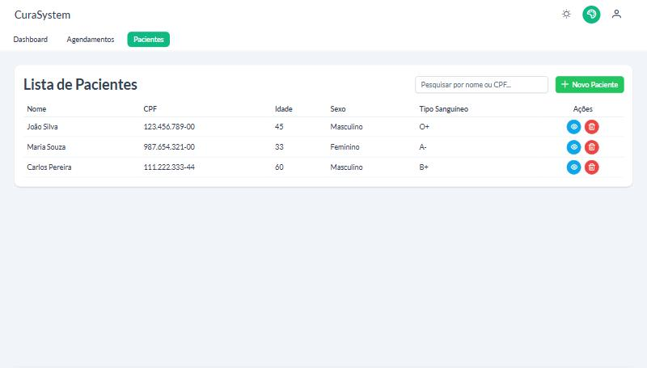

# CuraSystem · interoperabilidade em saúde

Trabalho de Conclusão de Curso. Uma plataforma que conecta sistemas de saúde públicos e
privados e centraliza o **prontuário do paciente em um único lugar**, para que qualquer
unidade de atendimento veja o histórico completo da pessoa, e não só o pedaço que ela mesma
registrou.

A palavra que resume a proposta é **interoperabilidade**: hoje cada hospital, clínica, posto
de saúde e laboratório guarda seus próprios dados, em formatos diferentes, e o paciente carrega
exames e receitas de um lugar para o outro. O CuraSystem propõe uma camada central, com uma
API padronizada, para onde esses sistemas enviam e de onde consomem o prontuário.

> Projeto acadêmico, em desenvolvimento. Esta versão implementa o núcleo da plataforma:
> cadastro e ficha do paciente, agenda de atendimentos e um painel de acompanhamento.

| Dashboard | Prontuário do paciente |
|---|---|
|  |  |

| Agenda | Lista de pacientes |
|---|---|
|  |  |

## O que já existe

**Pacientes**
- Lista com busca, cadastro e ficha detalhada.
- Dados pessoais, endereço (com busca por CEP), contato de emergência, tipo sanguíneo e
  alergias, que ficam no centro do prontuário.

**Agendamentos**
- Agenda visual (dia, semana e mês) com os atendimentos de cada paciente.
- Tipo de atendimento, profissional, status e observações.

**Dashboard**
- Indicadores e gráficos dos atendimentos e da base de pacientes.

**Acesso**
- Telas de login e cadastro de usuário (a autenticação é o próximo passo do roadmap).

## Arquitetura

```
front-end/   Angular 20 · PrimeNG · FullCalendar · Chart.js · Tailwind
back-end/    FastAPI · SQLAlchemy · Pydantic · MySQL
```

O front consome a API via HTTP (`src/environments/environment.ts`). O back expõe os recursos
em REST, com documentação automática em `/docs`:

| Recurso | Endpoints |
|---|---|
| Pacientes | `GET /pacientes` · `GET /pacientes/{id}` · `POST /pacientes` · `DELETE /pacientes/{id}` |
| Agendamentos | `GET /agendamentos` · `GET /agendamentos/{id}` · `POST /agendamentos` · `DELETE /agendamentos/{id}` |

Modelo de dados (SQLAlchemy): `pacientes` e `agendamentos`, com um paciente tendo vários
agendamentos. O banco é criado automaticamente na primeira execução e pode ser populado com
`db_seed.sql`.

## Como rodar

### Back-end

Pré-requisitos: Python 3.12+, [Poetry](https://python-poetry.org/) e um MySQL acessível.

```bash
cd back-end
poetry install
```

Crie um arquivo `.env` na pasta `back-end`:

```
DB_USER=root
DB_PASSWORD=sua_senha
DB_HOST=127.0.0.1
DB_PORT=3306
DB_NAME=projeto_tcc_db
```

Suba a API:

```bash
poetry run uvicorn main:app --reload --port 8000
```

A documentação interativa fica em http://localhost:8000/docs.

### Front-end

Pré-requisitos: Node 20+ e Angular CLI.

```bash
cd front-end
npm install
npm start
```

Abra http://localhost:4200. A URL da API é configurada em
`front-end/src/environments/environment.ts`.

## Roadmap

- Autenticação e perfis de acesso (unidade de saúde, profissional, paciente).
- Prontuário clínico completo: consultas, exames, prescrições e evolução.
- Conectores de integração com sistemas externos, seguindo o padrão
  [HL7 FHIR](https://www.hl7.org/fhir/) usado pela Rede Nacional de Dados em Saúde (RNDS).
- Consentimento do paciente sobre quem pode acessar o quê.
- Auditoria de acesso ao prontuário.

## Autora

**Sammadar dos Santos** · [LinkedIn](https://www.linkedin.com/in/sammadar-dos-santos) · [GitHub](https://github.com/Sammadar)
